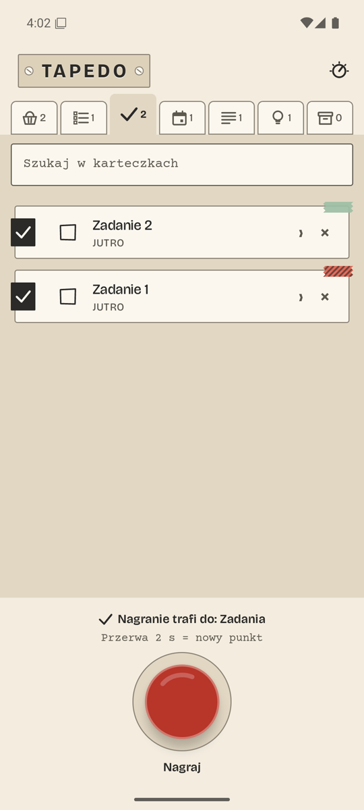
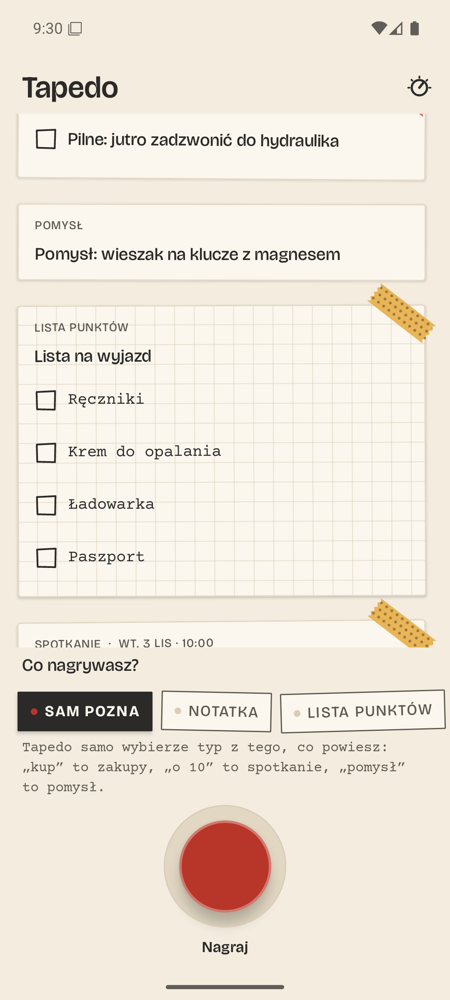

# Tapedo

[](https://github.com/Bakeron/tapedo/actions/workflows/tests.yml)

**Mów w biegu - Tapedo rozpisze to na karteczki.** Dyktafon na Androida, który zamienia szybkie notatki głosowe w osobne karteczki: notatki, listy do odhaczania, zadania z terminem, wydarzenia, pomysły i listy zakupów pogrupowane na działy sklepu. Działa bez internetu na prostych regułach, a lepiej - z darmowym AI na własnym kluczu.

[English description below](#tapedo---in-english)

<p>
  
  
  
  
</p>

## Co umie

- **Jeden duży przycisk nagrywania** - zapada się jak klawisz magnetofonu, telefon drga, ekran nie gaśnie, a pisak sejsmografu rysuje poziom głosu. Koniec po ciszy albo przyciskiem „stop”, z limitem długości.
- **Karteczki zamiast transkrypcji** - „Jutro oddać raport szefowi, to pilne. Zakupy: jajka, pomidory, mleko i kawa” to zadanie (na jutro, wysoki priorytet) i lista zakupów z działami.
- **Okno po nagraniu** - tekst wychodzi z maszyny do pisania, potem wpada na stos jako karteczki do poprawienia albo wyrzucenia. „Wstecz” zapisuje.
- **Stos karteczek** - odhaczanie na karcie (odręczne przekreślenie), edycja, „Udostępnij”, usuwanie z „Cofnij”.
- **Podgląd i „Dopisz głosem”** - jedna karteczka na cały ekran (np. lista zakupów w sklepie); głosem dopisuje się nowe punkty albo tekst.
- **AI opcjonalnie** - bez AI typ, priorytet, termin i godzinę wybierają reguły. Z Gemini albo Groq (darmowe plany, własny klucz) karteczki są lepsze, a przy błędzie AI notatkę i tak rozpisują reguły.
- Motyw jasny „Papier” i ciemny „Panel”, język polski i angielski, wielkość tekstu, opisy dla czytnika ekranu, „Ogranicz animacje”, układ w poziomie.

## Prywatność

- Notatki tylko na telefonie, w bazie zaszyfrowanej SQLCipher (AES-256), klucz chroniony przez Android Keystore.
- Tapedo nie zapisuje dźwięku - zostaje sam tekst.
- Rozpoznawanie mowy najpierw na telefonie. Przez internet (głos trafia do Google) dopiero po zgodzie: „tym razem” / „zawsze”, albo nigdy w Ustawieniach. Na starszych Androidach system może sam użyć internetu - aplikacja o tym mówi.
- Przy włączonym AI do dostawcy trafia tylko tekst notatki. Zasady każdego dostawcy są opisane w aplikacji przed wklejeniem klucza. Gemini tylko dla osób pełnoletnich (18+): klucz zakładasz na własnym koncie Google i korzystasz z niego na warunkach Google.
- Klucze API zaszyfrowane, nigdy w logach. Kopie zapasowe aplikacji wyłączone.
- Bez statystyk i bez raportów o awariach wysyłanych z telefonu.
- Gdy Android zgubi klucz szyfrowania, Tapedo nic nie kasuje - odkłada stare pliki, zaczyna od pustego stosu i wyjaśnia, co się stało.

## Uruchomienie

Wymagania: JDK 17 lub nowszy i Android SDK (platforma 37). Android Studio niepotrzebne.

```bash
./gradlew :app:assembleDebug        # app/build/outputs/apk/debug/app-debug.apk
./gradlew :core:test :app:testDebugUnitTest   # testy jednostkowe (uruchamia je też GitHub Actions po każdym push)
./gradlew :app:connectedDebugAndroidTest     # Keystore i zaszyfrowana baza - tylko na emulatorze
```

Gotowe APK będą w [GitHub Releases](https://github.com/Bakeron/tapedo/releases).

Emulator nie rozpoznaje mowy pewnie, więc wersja debug przyjmuje gotowy tekst (wersja release to ignoruje):

```bash
adb shell am start -n io.github.bakeron.tapedo/.MainActivity --es debug_transcript "'Zakupy: mleko, chleb i kawa'"
```

## Jak zbudowane

| Część | Wybór | Dlaczego |
|---|---|---|
| Język i ekrany | Kotlin, Jetpack Compose, Material 3 (mocno przerobiony) | Bezpośredni dostęp do rozpoznawania mowy, Keystore i ekranu; każda własna kontrolka w jednym języku |
| Logika | Moduł `core` w czystym Kotlinie (bez Androida) | Model notatek, reguły i klienci AI testowane na JVM w kilka sekund; gotowe na Kotlin Multiplatform |
| Baza | Room + SQLCipher | Zapytania sprawdzane przy kompilacji i cały plik zaszyfrowany |
| Ustawienia | DataStore | Asynchronicznie, bez czytania dysku na wątku głównym |
| AI | Klient Ktor, Gemini i Groq za jednym interfejsem | Wzorzec „strategia” - dostawców da się wymieniać; odpowiedzi JSON są sprawdzane |
| Połączenie części | Mały kontener pisany ręcznie | Mniej elementów niż Hilt przy aplikacji tej wielkości |

```
core/   model, reguły (tryb bez AI), klienci AI, interfejsy funkcji telefonu   - testy JVM
app/    ekrany Compose, rozpoznawanie mowy, Keystore, zaszyfrowany Room, DataStore
```

Wygląd wynika z jednego pomysłu - **dyktafon kieszonkowy i papierowe fiszki**: taśmy z drukarki etykiet do wyboru typu, sejsmograf dla głosu, papier w kratkę dla list, taśma na rogu dla priorytetu (kolor i wzór, czytelne bez rozróżniania kolorów), niebieska pieczątka zamiast „iskierek AI”.

## Jak powstało

Jestem programistą WordPress bez doświadczenia z Androidem. Tapedo powstaje z [Claude Code](https://claude.com/claude-code): ja decyduję, co aplikacja ma robić i co jest do przyjęcia, a Claude proponuje architekturę, pisze kod i go tłumaczy. Proces jest częścią projektu:

- decyzje i otwarte pytania spisuję w notatkach, zanim powstanie kod (plan i dziennik budowy, punkty z audytów czekające na moją decyzję);
- każdy krok sprawdzany na emulatorze zrzutami ekranu, 86 testów jednostkowych i 9 testów na emulatorze (Keystore, zaszyfrowana baza);
- kod przechodzi audyty z Claude Code według moich list kontrolnych (poprawność, uproszczenia, wydajność, bezpieczeństwo, dostępność, wygląd, teksty, wydanie, zależności, testy, portfolio). Oczywiste poprawki z audytów wchodzą od razu, a to, co wymaga mojej decyzji, zostaje spisane z propozycją i czeka na mnie.

Kod i komentarze są po angielsku, notatki i opisy commitów po polsku.

## Stan

Etap 1a (rdzeń) - prawie gotowy:

- zrobione: nagrywanie, rozpoznawanie mowy na telefonie i przez internet, reguły bez AI, Gemini i Groq, okno po nagraniu, stos karteczek z edycją, odhaczaniem, udostępnianiem i cofaniem, zaszyfrowana baza, motywy, PL / EN, dostępność, ekran licencji;
- do zrobienia: test mowy na prawdziwym telefonie, podpisany APK w GitHub Releases, GIF z działania.

Dalej (1b): rozpoznawanie mowy Whisper, więcej dostawców AI, tryb prywatny, blokada aplikacji, widżet na ekran główny.

## Licencja

[MIT](LICENSE). Licencje bibliotek i krojów pisma (SQLCipher, AndroidX, Kotlin, Ktor, OkHttp, czcionki): w aplikacji, Ustawienia → Licencje open source.

---

# Tapedo - in English

**Speak on the go - Tapedo turns it into index cards.** An Android voice recorder that cuts quick spoken notes into separate cards: notes, checklists, tasks with due dates, events, ideas and shopping lists grouped by shop section. It works offline with simple rules, or better with a free AI model using your own key. Screenshots are at the top of the page.

## What it does

- **One big record key.** It sinks like a tape recorder key, the phone buzzes, the screen stays on, and a seismograph pen draws your voice level. Recording ends on silence or with "stop", with a length limit you set.
- **Cards, not a transcript.** "Tomorrow hand in the report, it's urgent. Shopping: eggs, tomatoes, milk and coffee" becomes a task (due tomorrow, high priority) and a shopping list grouped into produce, dairy and drinks.
- **Review before saving.** The text comes out of a typewriter letter by letter, then drops in as cards you can edit or throw away. Back saves - notes are kept by default.
- **A stack you can work with.** Tick list items and tasks right on the card (a hand-drawn strike-through), edit, share as plain text, delete with undo.
- **AI is optional.** Without AI, keyword rules decide the type, priority ("urgent"), due date ("tomorrow", "on Friday") and event time ("at 10"). With Gemini or Groq (free plans, your own key) the cards are better. Any AI error falls back to the rules - a note is never lost.
- **Light "Paper" and dark "Panel" themes**, Polish and English, screen reader labels, a "reduce motion" switch, a landscape layout.

## Privacy

Designed for notes that may contain sensitive data:

- Notes are stored only on the phone, in a database encrypted with SQLCipher (AES-256). The database key is protected by the Android Keystore.
- Tapedo never saves sound - only the recognised text is kept.
- Speech recognition runs on the phone first. If the phone has no offline language pack, Tapedo asks before using online recognition (which sends your voice to Google): "this time" / "always", or never in Settings. On older Android versions the system may go online by itself - the app says so.
- With an AI provider switched on, only the note text goes to that provider (Google Gemini or Groq) - no audio, no other data. Each provider's data policy is explained in the app before you paste a key. Gemini is for adults only (18+): you create the key in your own Google account and use it under Google's terms.
- API keys are encrypted with the Keystore and never written to logs. App backups are turned off, so the database does not leave the phone in a cloud backup.
- No analytics and no crash reports sent from the phone.
- If Android ever loses the encryption key, Tapedo does not delete anything: it sets the old files aside, starts an empty stack and tells you why.

## Build and run

Requirements: JDK 17 or newer and the Android SDK (platform 37). No Android Studio needed.

```bash
./gradlew :app:assembleDebug        # app/build/outputs/apk/debug/app-debug.apk
./gradlew :core:test :app:testDebugUnitTest   # unit tests (also run by GitHub Actions on every push)
./gradlew :app:connectedDebugAndroidTest     # Keystore and encrypted database - on an emulator only
```

Ready-made APKs will be published on [GitHub Releases](https://github.com/Bakeron/tapedo/releases).

The emulator cannot recognise speech reliably, so debug builds accept a ready transcript:

```bash
adb shell am start -n io.github.bakeron.tapedo/.MainActivity --es debug_transcript "'Shopping: milk, bread and coffee'"
```

Release builds ignore it.

## How it is built

| Part | Choice | Why |
|---|---|---|
| Language and UI | Kotlin, Jetpack Compose, Material 3 (heavily restyled) | Native access to speech recognition, Keystore and the screen; Compose keeps every custom control in one language |
| Logic | `core` module in plain Kotlin (no Android) | Note model, keyword rules and AI clients are testable on the JVM in seconds and ready for Kotlin Multiplatform later |
| Database | Room + SQLCipher | Typed queries and a fully encrypted file |
| Settings | DataStore | Asynchronous, no main-thread disk access |
| AI | Ktor client, Gemini and Groq behind one interface | Strategy pattern - providers are swappable; JSON answers are validated |
| Wiring | A small hand-written container | Fewer moving parts than Hilt for an app this size |

The look follows one idea - **a pocket recorder and paper index cards**: label-maker tapes for the type picker, a seismograph for the voice, squared paper for lists, tape on the corner for priority (colour and pattern, readable without colour vision), a blue rubber stamp instead of AI sparkles.

## Built with AI

I am a WordPress developer without Android experience. Tapedo is written with [Claude Code](https://claude.com/claude-code): I decide what the app should do, how it should behave and what is acceptable; Claude proposes the architecture, writes the code and explains it. The process is part of the project:

- decisions and open questions are written down in notes before they are built (build plan and log, audit points waiting for my decision);
- every step is checked on an emulator with screenshots, with 86 unit tests and 9 instrumented tests on the emulator (Keystore, encrypted database);
- the code goes through audits with Claude Code, following my own checklists - code correctness, simplification, performance, security, plus shared audits of accessibility, look, texts, release readiness, dependencies, tests and portfolio. Clear-cut findings are fixed right away; anything that needs my decision is written down with a proposal and waits for me.

Code and comments are in English; notes and commit messages are in Polish.

## Status

Stage 1a (the core) - almost ready:

- done: recording, offline / online speech recognition, no-AI rules, Gemini and Groq, review window, card stack with editing, ticking, sharing and undo, encrypted database, themes, PL / EN, accessibility pass, licences screen;
- still to do: speech test on a real phone, a signed release APK on GitHub Releases, a demo GIF.

Next (1b): Whisper transcription, more AI providers, private mode, app lock, a home-screen widget.

## Licence

[MIT](LICENSE). Third-party licences (SQLCipher, AndroidX, Kotlin, Ktor, OkHttp, the fonts) are listed in the app: Settings → Open source licences.
