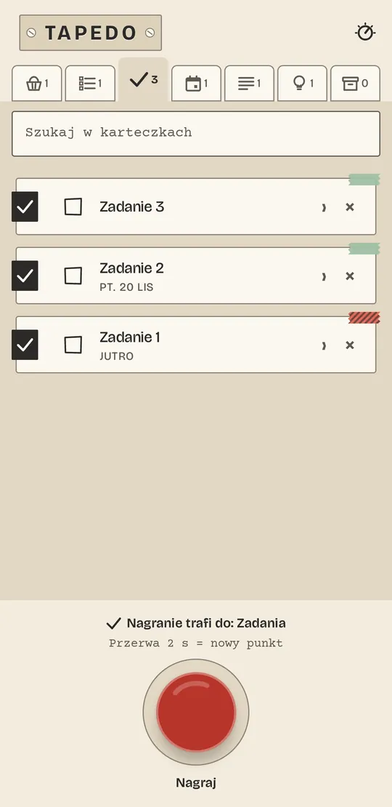
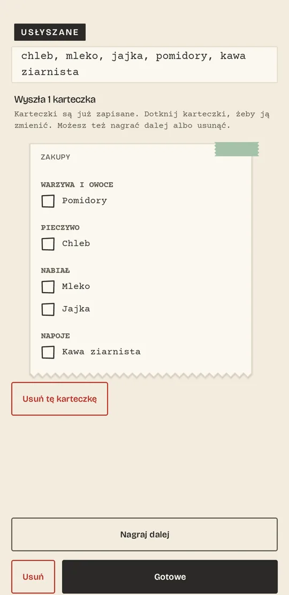
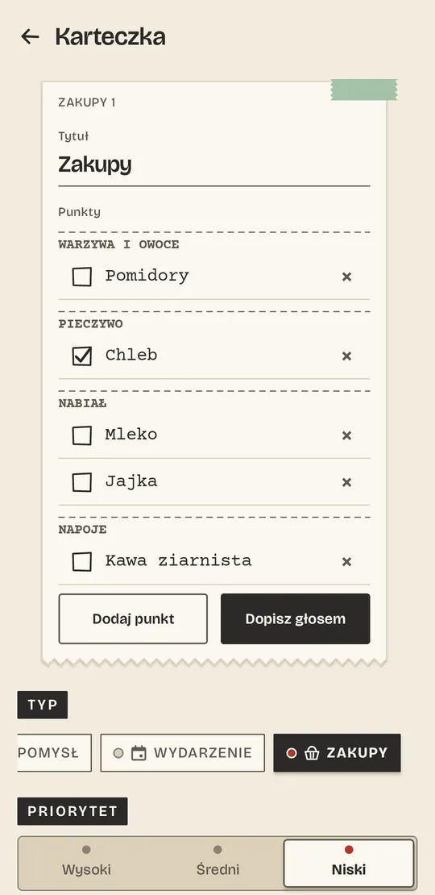
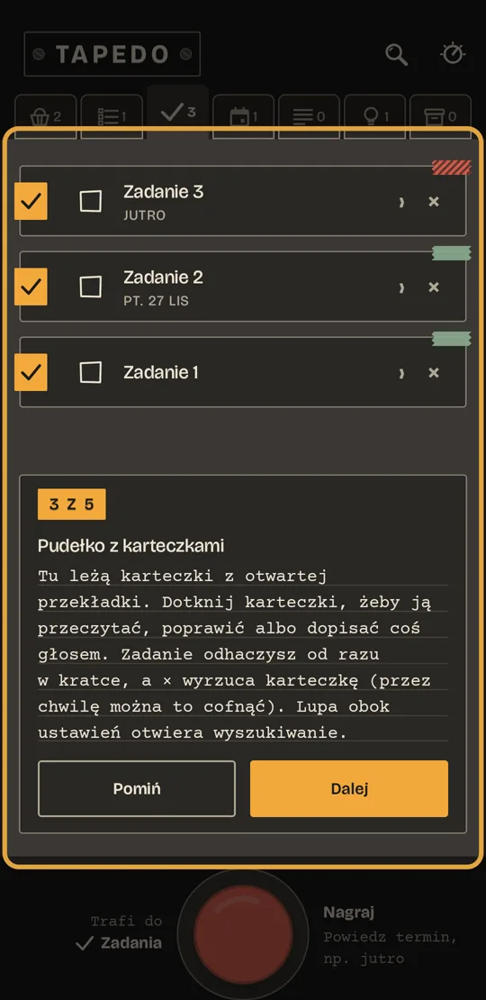
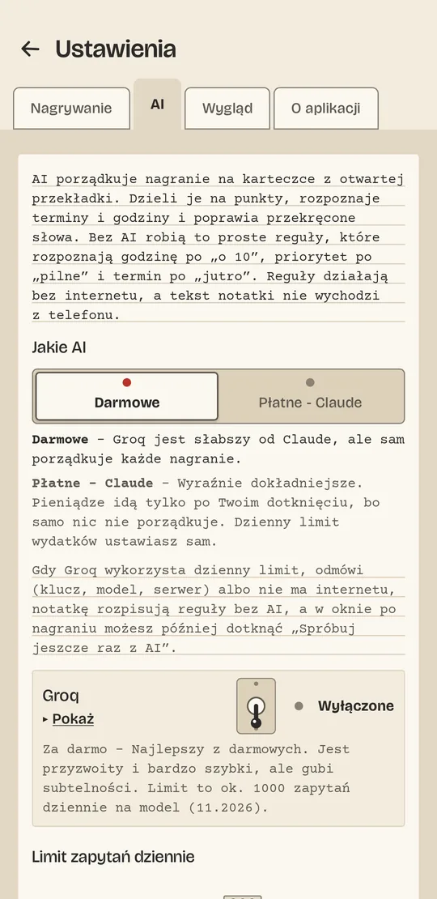

# Tapedo

[](https://github.com/Bakeron/tapedo/actions/workflows/tests.yml)

Dyktafon na Androida, który zamienia krótką notatkę głosową w karteczki, czyli zadania z terminem, listy zakupów i pomysły. Działa bez internetu, a z AI lepiej rozumie notatki.

Wersja demonstracyjna działa w przeglądarce, bez mikrofonu i na wymyślonych karteczkach: [wersja demonstracyjna](https://tapedo.szymonbakonis.pl) · [instrukcja ze zrzutami](https://tapedo.szymonbakonis.pl/instrukcja/) · [moje projekty](https://szymonbakonis.pl)

[English summary below](#in-english)

<p>
  
  
  
  
  
</p>

## Co umie

- **Duży przycisk nagrywania** - zapada się jak klawisz magnetofonu, a telefon przy tym drga. Ekran nie gaśnie, a pisak sejsmografu rysuje poziom głosu. Nagranie kończy się po ciszy albo przyciskiem „stop” i ma limit długości.
- **Karteczki zamiast transkrypcji** - z notatki „Jutro oddać raport szefowi, to pilne. Zakupy: jajka, pomidory, mleko i kawa” powstają dwie karteczki. Pierwsza to pilne zadanie na jutro, a druga to lista zakupów podzielona na działy sklepu.
- **Okno po nagraniu** - tekst wychodzi z maszyny do pisania i wpada na stos jako karteczki. Każdą można poprawić albo wyrzucić. „Wstecz” zapisuje karteczki.
- **Kartoteka z przekładkami** - na górze są znaki rodzajów (zakupy, listy, zadania, wydarzenia, notatki, pomysły, zrobione) z liczbą karteczek. Otwarta przekładka to rodzaj następnego nagrania.
- **Praca na karteczce** - punkt albo zadanie odhacza się na karcie odręcznym przekreśleniem. Karteczkę można też edytować, udostępnić i usunąć z możliwością cofnięcia.
- **Karteczka na cały ekran** - pisze się na niej od razu, na przykład na liście zakupów w sklepie. Przycisk „Dopisz głosem” dodaje nowe punkty albo tekst. Każda zmiana zapisuje się sama.
- **Pauza jako nowy punkt** - przerwa w mówieniu zaczyna nowy punkt listy. Jej długość ustawia się od 0 do 10 sekund (domyślnie 2), a „Nigdy” robi z całego nagrania jeden punkt.
- **AI jako opcja** - bez AI rodzaj, priorytet, termin i godzinę wybierają proste reguły. Darmowe AI (Groq, własny klucz) porządkuje każde nagranie samo. Płatny Claude działa tylko po dotknięciu „Dokładniej”, z dziennym limitem wydatków w dolarach i kwotą w złotych po kursie NBP. Oba rodzaje AI nigdy nie działają naraz. Przy błędzie AI notatkę i tak rozpisują reguły.
- **Wygląd i dostępność** - jasny motyw „Papier” i ciemny „Panel”, język polski i angielski. Do tego wielkość tekstu, opisy dla czytnika ekranu, „Ogranicz animacje”, „Krzywe karteczki” (domyślnie wyłączone) i układ w poziomie.

## Prywatność

- Notatki są tylko na telefonie, w bazie zaszyfrowanej SQLCipher (AES-256). Klucz do bazy chroni Android Keystore.
- Tapedo nie zapisuje dźwięku, zostaje sam tekst. Nagranie nigdy nie wychodzi z telefonu.
- Rozpoznawanie mowy działa najpierw na telefonie. Przez internet (głos trafia wtedy do Google) działa dopiero po zgodzie „tym razem” albo „zawsze”, a w Ustawieniach można je wyłączyć na stałe. Na starszych Androidach system może sam użyć internetu i aplikacja o tym mówi.
- Przy włączonym AI do dostawcy trafia tylko tekst notatki. Zasady każdego dostawcy aplikacja opisuje przed wklejeniem klucza.
- Klucze API są zaszyfrowane i nigdy nie trafiają do logów. Kopie zapasowe aplikacji są wyłączone.
- Aplikacja nie zbiera statystyk i nie wysyła raportów o awariach.
- Gdy Android zgubi klucz szyfrowania, Tapedo nic nie kasuje. Odkłada stare pliki, zaczyna od pustego stosu i wyjaśnia, co się stało.
- Pełna polityka prywatności (PL i EN) jest pod adresem [tapedo.szymonbakonis.pl/privacy.html](https://tapedo.szymonbakonis.pl/privacy.html).

## Uruchomienie

Do budowania potrzebne są JDK 17 lub nowszy i Android SDK (platforma 37). Android Studio nie jest potrzebne.

```bash
./gradlew :app:assembleDebug        # app/build/outputs/apk/debug/app-debug.apk
./gradlew :core:test :app:testDebugUnitTest   # testy jednostkowe (uruchamia je też GitHub Actions po każdym push)
./gradlew :app:connectedDebugAndroidTest     # Keystore i zaszyfrowana baza - tylko na emulatorze
```

Gotowe APK będą w [GitHub Releases](https://github.com/Bakeron/tapedo/releases).

Emulator nie rozpoznaje mowy pewnie, więc wersja debug przyjmuje gotowy tekst (wersja release to ignoruje):

```bash
adb shell am start -n io.github.bakeron.tapedo/.MainActivity --es debug_transcript "'Zakupy: mleko, chleb i kawa'"
```

## Jak zbudowane

| Część | Wybór | Dlaczego |
|---|---|---|
| Język i ekrany | Kotlin, Jetpack Compose, Material 3 (mocno przerobiony) | Bezpośredni dostęp do rozpoznawania mowy, Keystore i ekranu. Wszystkie własne kontrolki w jednym języku. |
| Logika | Moduł `core` w czystym Kotlinie (bez Androida) | Model notatek, reguły i klienci AI są testowane na JVM w kilka sekund. Moduł jest gotowy na Kotlin Multiplatform. |
| Baza | Room + SQLCipher | Zapytania sprawdzane przy kompilacji i cały plik zaszyfrowany |
| Ustawienia | DataStore | Asynchronicznie, bez czytania dysku na wątku głównym |
| AI | Klient Ktor, dostawcy (Groq, Claude, a w kodzie też ukryci OpenAI i Gemini) za jednym interfejsem | Wzorzec „strategia”, więc dostawców da się wymieniać. Odpowiedzi JSON są sprawdzane. |
| Połączenie części | Mały kontener pisany ręcznie | Mniej elementów niż Hilt przy aplikacji tej wielkości |

```
core/   model, reguły (tryb bez AI), klienci AI, interfejsy funkcji telefonu   - testy JVM
app/    ekrany Compose, rozpoznawanie mowy, Keystore, zaszyfrowany Room, DataStore
```

Wygląd wynika z jednego pomysłu, czyli **dyktafonu kieszonkowego i papierowych fiszek**. Rodzaj karteczki wybiera się taśmami z drukarki etykiet, głos rysuje sejsmograf, a listy leżą na papierze w kratkę. Priorytet pokazuje taśma na rogu w kolorze i ze wzorem, więc da się go odczytać bez rozróżniania kolorów. Zamiast „iskierek AI” jest niebieska pieczątka.

## Jak powstało

Jestem programistą WordPress bez doświadczenia z Androidem. Cały kod napisał [Claude Code](https://claude.com/claude-code), a ja projektowałem ekrany i reguły rozpoznawania, pilnowałem testów i sprawdzałem każdą zmianę. Sposób pracy jest częścią projektu:

- Decyzje i otwarte pytania trafiają do notatek, zanim powstanie kod. Są tam plan i dziennik budowy oraz punkty z audytów, które czekają na moją decyzję.
- Każdy krok jest sprawdzany na emulatorze zrzutami ekranu. Projekt ma 198 testów jednostkowych i 9 testów na emulatorze (Keystore, zaszyfrowana baza).
- Kod przechodzi audyty z Claude Code według moich list kontrolnych. Sprawdzają poprawność, uproszczenia, wydajność, bezpieczeństwo, dostępność, wygląd, teksty, wydanie, zależności, testy i portfolio. Oczywiste poprawki wchodzą od razu, a sprawy do mojej decyzji czekają spisane z propozycją.

Kod i komentarze są po angielsku, a notatki i opisy commitów po polsku.

## Stan

Etap 1a, czyli rdzeń aplikacji, jest prawie gotowy.

- **Zrobione** - nagrywanie, rozpoznawanie mowy na telefonie i przez internet, reguły bez AI, darmowe AI (Groq) albo płatny Claude z limitem wydatków. Do tego okno po nagraniu, stos karteczek z edycją, odhaczaniem, udostępnianiem i cofaniem, zaszyfrowana baza, motywy, PL i EN, dostępność, ekran licencji, pierwsze kroki, instrukcja i wersja demonstracyjna w przeglądarce.
- **Do zrobienia** - podpisany APK w GitHub Releases i GIF z działania.

W etapie 1b planowane są tryb prywatny, blokada aplikacji i widżet na ekran główny.

## Licencja

[MIT](LICENSE). Licencje bibliotek i krojów pisma (SQLCipher, AndroidX, Kotlin, Ktor, OkHttp, czcionki) są w aplikacji, w Ustawieniach → Licencje open source.

---

## In English

An Android voice recorder that turns a short spoken note into index cards, such as tasks with a due date, shopping lists grouped by shop section, and ideas. It works offline with simple rules and understands notes better with AI.

- Speech recognition on the phone (offline when the phone can), online only after the user agrees.
- Optional AI, either free (Groq, own key) or paid Claude with a daily spending limit.
- Notes stay on the phone in an encrypted database (SQLCipher, Android Keystore). No analytics and no crash reports.
- Light and dark theme, Polish and English, screen reader labels and a "reduce motion" switch.

Built with Kotlin, Jetpack Compose and Android. All code was written by Claude Code, while I designed the screens and the recognition rules, kept an eye on the tests and reviewed every change.

[Browser demo](https://tapedo.szymonbakonis.pl/?lang=en) · [privacy policy](https://tapedo.szymonbakonis.pl/privacy.html#en). The full description is in Polish above.
